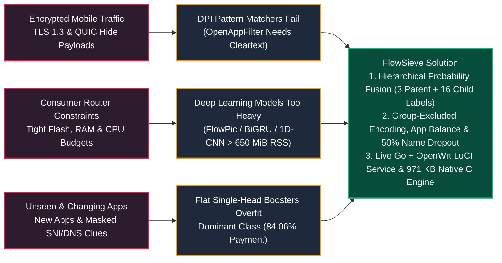
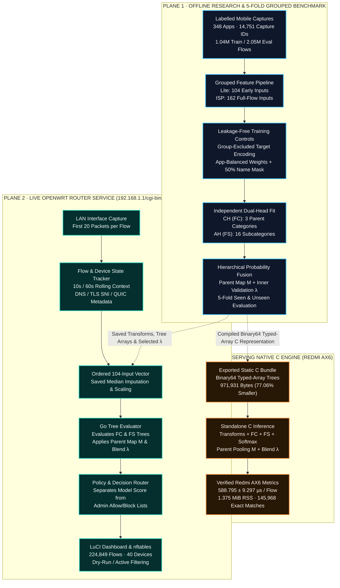
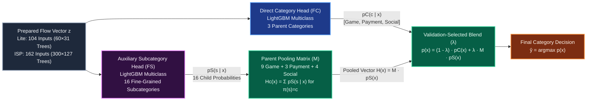
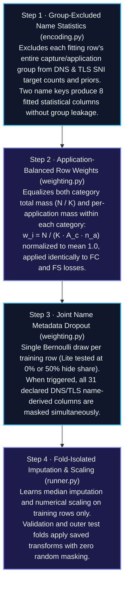

# FlowSieve: Encrypted Mobile Traffic Classification and Category-Based Filtering Using Hierarchical Probability Fusion

> **M.Eng. Thesis & Smart Router Security Research** · School of Computer Science and Technology, Southwest University of Science and Technology (SWUST)  
> **Author:** Saim Uddin Samrat Sha Emon (`@SAMRAT-SHA-EMON`) · **Supervisor:** Prof. Huang Xiaofang · **OpenWrt LuCI Service:** `/cgi-bin/luci/admin/services/flowsieve`

## Executive Summary & Key Metrics Infographic

| Dataset & Evaluation Scale | Classification Performance (ISP) | Edge Hardware (Redmi AX6 Native C) | Live OpenWrt LuCI Deployment |
| :--- | :--- | :--- | :--- |
| **348** Mobile Applications<br/>`87 Game · 181 Payment · 80 Social`<br/>**14,751** Capture Identities<br/>**2,054,048** Outer Eval Flows/Protocol<br/>**5-Fold** Seen & Unseen Splits | **97.52%** Seen Accuracy (`92.22% F1`)<br/>**89.69%** Unseen Accuracy (`72.37% F1`)<br/>**+3.92 pp** Unseen Acc vs. LightGBM<br/>**+3.20 pp** Unseen F1 vs. LightGBM<br/>**+4.19 pp** Lite Unseen F1 via App Balance | **588.80 µs** / Flow Inference<br/>**971.93 KB** Full Binary Package<br/>**77.06%** Storage Reduction vs. Python<br/>**1.375 MiB** Peak Process RSS<br/>**145,968** Flows Exact Agreement | **224,849** Live Classified Flows<br/>**40** Tracked LAN Client Devices<br/>**20-Packet** Early Flow Window<br/>**10s / 60s** Device State Context<br/>**Opt-in `nftables`** Policy Filtering |

## 1. Why Behavioral Category Filtering on Smart Routers?



## 2. Three-Plane System Architecture Infographic

FlowSieve maintains strict boundaries between **Offline Grouped Research**, the **Implemented OpenWrt / Go Router Service (`192.168.1.1/cgi-bin/luci/admin/services/flowsieve`)**, and the **Native C Hardware Study on Redmi AX6**:



## 3. Hierarchical Probability Fusion & Training Controls

### 3.1 Dual-Head Probability Fusion Architecture (Contribution 1)



* **Mathematical Formulation:** Given flow representation $x$, the direct head produces $p_C(c \mid x)$ over $C = \{\text{Game}, \text{Payment}, \text{Social-Media}\}$ and the auxiliary head produces $p_S(s \mid x)$ over 16 subcategories. Using parent assignment $\pi(s) = c$:

$$H_c(x) = \sum_{s:\pi(s)=c} p_S(s \mid x), \qquad p_c(x) = (1 - w_f)\,p_C(c \mid x) + w_f\,H_c(x), \qquad \hat{y} = \arg\max_{c \in C} p_c(x)$$

* **Inner-Validation Selection:** The blend weight $w_f \in [0, 1]$ (denoted $\lambda$ in diagrams) is chosen strictly on inner validation within each outer fold ($w_f = 0$ recovers flat direct classification; $w_f = 1$ uses purely pooled subcategory probabilities).

### 3.2 Grouped Training Controls: Encoding, Balancing & Metadata Dropout (Contribution 2)



## 4. OpenWrt LuCI Router Implementation (`/cgi-bin/luci/admin/services/flowsieve`)

FlowSieve integrates directly into the OpenWrt administration stack at `192.168.1.1/cgi-bin/luci/admin/services/flowsieve`, coupling live LAN traffic capture with real-time tree inference and `nftables` policy control.

### 4.1 Live Router Service & LuCI Dashboard Architecture

```text
+--------------------------------------------------------------------------------------------------+
| OpenWrt LuCI · Services -> FlowSieve              192.168.1.1/cgi-bin/luci/admin/services/flowsieve |
+--------------------------------------------------------------------------------------------------+
| [ SERVICE STATUS: RUNNING ]   [ POLICY MODE: DRY-RUN / OPT-IN NFTABLES ]   [ ENGINE: GO + LITE ] |
+-------------------------------+----------------------------------+-------------------------------+
| CLASSIFIED FLOWS              | ACTIVE LAN DEVICES               | MODEL / ADMIN SEPARATION      |
| 224,849 Flows                 | 40 Client Devices                | Model Score != Admin List     |
| 100% Model Coverage           | 10s & 60s Rolling Context        | Explicit Decision Source Tag  |
+-------------------------------+----------------------------------+-------------------------------+
| LIVE TRAFFIC CLASSIFICATION & CATEGORY FILTERING STREAM                                          |
| Flow / Client IP    Proto   Early Pkts   Parent Category   Subcategory      Confidence   Source  |
| 192.168.1.x:443     QUIC    20 pkts      Social-Media      Short-Video      0.94         Model   |
| 192.168.1.x:30120   UDP     20 pkts      Game              Real-Time-PVP    0.91         Model   |
| 192.168.1.x:443     TLS1.3  20 pkts      Payment           Mobile-Wallet    0.98         Model   |
+--------------------------------------------------------------------------------------------------+
```

### 4.2 End-to-End Router Execution & Native C Verification (Contribution 3)

| Layer | Component | Input & Execution Boundary | Measured Performance & Verification |
| :--- | :--- | :--- | :--- |
| **LuCI Control Plane** | `luci-app-flowsieve`<br/>(`/cgi-bin/luci/admin/services/flowsieve`) | Polls Go service state, displays per-category flow counters, device activity, network-learning status, and toggles `Dry-Run` vs. active `nftables` blocking. | Verified on live router deployment with **224,849 classified flows** and **40 connected devices**. |
| **Go Data Plane** | `router-service` daemon | Captures LAN frames, tracks connection state over the **first 20 packets** and **10 s / 60 s device windows**, constructs the ordered **104-input Lite vector**, and runs the Go tree evaluator. | Preserves both predicted model category and decision source (`Model` vs. `Admin Allow/Block List`). |
| **Native C Engine** | `native-c` on **Redmi AX6** | Compiles typed-array trees ($F_C$ + $F_S$), frozen preprocessing/name tables, Binary64 thresholds, softmax, parent pooling ($M$), and blend ($\lambda$) into static C arrays. | **971,931 B (0.927 MiB)** total size (**77.06% reduction** vs. 4.04 MiB Python bundle), **1.375 MiB** peak RSS, **588.795 ± 9.297 µs/flow**, **100% agreement** on 145,968 flows (`79.64%` inner acc / `77.98%` inner F1). |

## 5. Experimental Benchmark & Visual Leaderboard

### 5.1 Unseen Applications Leaderboard (ISP Tier · 5-Fold Application-Disjoint Mean ± SD)

FlowSieve is benchmarked against **7 published comparator families** across all **348 applications** (`2,054,048` evaluation flows per protocol). On **Unseen Applications (Application-Disjoint)**, **FlowSieve-ISP** achieves the highest natural Accuracy (**89.69%**) and Macro-F1 (**72.37%**) among all completed comparators in the matched table:

| Rank | Model / Comparator Family | Unseen Accuracy (%) | Unseen Macro-F1 (%) | Visual Macro-F1 Comparison |
| :---: | :--- | :---: | :---: | :--- |
| **1** | **FlowSieve-ISP (Main · Dual-Head Fusion)** | **89.69 ± 5.25** | **72.37 ± 8.64** | `██████████████████░░` **72.37%** |
| 2 | AppScanner (Adapted RF) | 89.52 ± 4.32 | 71.10 ± 7.65 | `█████████████████▓░░` 71.10% |
| 3 | FlowPic (Adapted CNN + Dense) | 87.00 ± 5.67 | 69.82 ± 5.90 | `█████████████████░░░` 69.82% |
| 4 | Brain-on-Switch (Adapted) | 86.27 ± 7.44 | 69.28 ± 6.51 | `█████████████████░░░` 69.28% |
| 5 | Standard LightGBM Baseline | 85.77 ± 9.60 | 69.17 ± 10.61 | `█████████████████░░░` 69.17% |
| 6 | Pegasus CNN (Adapted) | 85.55 ± 8.20 | 68.47 ± 7.36 | `█████████████████░░░` 68.47% |
| 7 | Pegasus RNN (Adapted) | 84.66 ± 9.52 | 67.53 ± 8.84 | `████████████████▓░░░` 67.53% |
| 8 | Pegasus MLP (Adapted) | 84.50 ± 9.53 | 66.91 ± 9.65 | `████████████████▓░░░` 66.91% |
| 9 | Akem RF (First-Packet Adapted) | 80.19 ± 10.70 | 58.22 ± 6.78 | `██████████████▓░░░░░` 58.22% |

### 5.2 Seen Applications Leaderboard (ISP Tier · 5-Fold Capture-Disjoint Mean ± SD)

| Rank | Model / Comparator Family | Seen Accuracy (%) | Seen Macro-P (%) | Seen Macro-R (%) | Seen Macro-F1 (%) | Visual Macro-F1 Comparison |
| :---: | :--- | :---: | :---: | :---: | :---: | :--- |
| **1** | **FlowSieve-ISP (Main · Dual-Head Fusion)** | **97.52 ± 0.56** | **91.94 ± 2.92** | 92.93 ± 2.20 | **92.22 ± 2.73** | `██████████████████▓░` **92.22%** |
| 2 | AppScanner (Adapted RF) | 97.05 ± 0.48 | 90.70 ± 3.34 | 92.65 ± 1.24 | 91.53 ± 2.43 | `██████████████████░░` 91.53% |
| 3 | Pegasus MLP (Adapted) | 96.62 ± 0.21 | 86.90 ± 1.44 | 93.76 ± 0.76 | 89.97 ± 1.22 | `██████████████████░░` 89.97% |
| 4 | Standard LightGBM Baseline | 96.42 ± 0.49 | 86.12 ± 2.47 | 93.60 ± 1.82 | 89.33 ± 2.51 | `█████████████████▓░░` 89.33% |
| 5 | Pegasus CNN (Adapted) | 96.31 ± 0.38 | 85.55 ± 1.92 | **93.87 ± 0.79** | 89.16 ± 1.53 | `█████████████████▓░░` 89.16% |
| 6 | Pegasus RNN (Adapted) | 96.30 ± 0.50 | 85.80 ± 2.74 | 93.57 ± 1.34 | 89.10 ± 2.55 | `█████████████████▓░░` 89.10% |
| 7 | Brain-on-Switch (Adapted) | 96.09 ± 0.60 | 85.53 ± 2.32 | 93.23 ± 1.48 | 88.87 ± 2.11 | `█████████████████▓░░` 88.87% |
| 8 | FlowPic (Adapted) | 95.54 ± 0.75 | 83.21 ± 3.26 | 92.26 ± 1.62 | 86.98 ± 3.04 | `█████████████████░░░` 86.98% |
| 9 | Akem RF (Adapted) | 94.04 ± 0.39 | 80.64 ± 1.44 | 85.01 ± 0.45 | 82.58 ± 1.00 | `████████████████▓░░░` 82.58% |

### 5.3 Controlled Ablation Study & Category-Level Unseen Performance

| Ablation / Diagnostic Dimension | Baseline Control | Modified Configuration | Measured Effect | Key Insight |
| :--- | :---: | :---: | :---: | :--- |
| **ISP Hierarchy + Capacity (Unseen)** | Flat 300×127 (`71.08% F1`) | Two-Head Fixed (`73.52%`) / Main (`72.37%`) | **+2.44 pp** / **+1.29 pp F1** | Subcategory supervision + pooling improves unseen precision (`73.33%` vs. `67.66%` Std). |
| **Lite Application Balancing (Unseen)** | Fixed Two-Head (`64.14% F1`) | Equal App Weights $N/(3A_c n_a)$ (`68.33% F1`) | **+4.19 ± 5.96 pp F1** | Improves **4 of 5** unseen outer folds by preventing high-volume apps from dominating splits. |
| **Lite 50% Metadata Dropout (Unseen)** | Fixed Two-Head (`64.14% F1`) | 50% Row Mask on 31 Name Cols (`66.87% F1`) | **+2.73 ± 8.05 pp F1** | Improves **4 of 5** unseen outer folds when DNS/TLS server-name cues shift across apps. |
| **Unseen Per-Category Recognition (ISP)** | Natural Flow Mix (`84.06% Payment`) | Pooled 5-Fold Outer Predictions | **Payment:** `96.02% Recall` (`95.52% F1`)<br/>**Game:** `63.32% Recall` (`69.33% F1`)<br/>**Social:** `63.55% Recall` (`52.26% F1`) | Explains why high overall accuracy (`89.69%`) must always be paired with Macro-F1 (`72.37%`). |

## 6. Repository Structure

```text
Flowsieve/
├── README.md                  # Infographic overview, Mermaid architecture diagrams, LuCI UI & benchmark tables
├── benchmark_midterm/         # 5-fold grouped benchmark pipeline
│   ├── models.py              # Dual-head LightGBM (FC + FS), parent map M, and probability fusion (λ)
│   ├── encoding.py            # Group-excluded DNS/TLS server-name target statistics
│   ├── weighting.py           # Application-balanced row weights w = N/(K*Ac*na) & 31-col name dropout
│   └── runner.py              # Inner-validation selection, outer-fold refitting, and metric evaluation
├── router-service/            # Live Go LAN packet capture (20 packets + 10s/60s context) & tree evaluator
├── luci-app-flowsieve/        # OpenWrt LuCI administration module (/cgi-bin/luci/admin/services/flowsieve)
├── native-c/                  # Standalone Binary64 typed-array C inference engine for Redmi AX6
└── configs/                   # 3-parent / 16-subcategory taxonomy map and opt-in nftables policy templates
```

## 7. References

1. G. Ke et al., *LightGBM: A Highly Efficient Gradient Boosting Decision Tree*, Advances in Neural Information Processing Systems (NeurIPS), 2017.
2. V. F. Taylor et al., *AppScanner: Automatic Fingerprinting of Smartphone Apps from Encrypted Network Traffic*, IEEE EuroS&P, 2016.
3. T. Shapira and Y. Shavitt, *FlowPic: A Generic Representation for Encrypted Traffic Classification and Applications Identification*, IEEE Transactions on Network and Service Management (TNSM), 2021.
4. J. Yan et al., *Brain-on-Switch: Towards Advanced Intelligent Network Data Plane via NN-Driven Traffic Analysis at Line-Speed*, USENIX NSDI, 2024.
5. Y. Zhang et al., *Pegasus: A Universal Framework for Scalable Deep Learning Inference on the Dataplane*, ACM SIGCOMM, 2025.
6. A. Tanyi-Jong Akem, G. Fraysse, and M. Fiore, *Encrypted Traffic Classification at Line Rate in Programmable Switches with Machine Learning*, IEEE/IFIP NOMS, 2024.
7. Z. Aouini and A. Pekar, *NFStream: A Flexible Network Data Analysis Framework*, Computer Networks, 2022.

## 8. Author & Contact

* **Author:** Saim Uddin Samrat Sha Emon (`@SAMRAT-SHA-EMON`)
* **Supervisor:** Prof. Huang Xiaofang
* **Institution:** School of Computer Science and Technology, Southwest University of Science and Technology (SWUST), Mianyang, Sichuan, China
* **Email:** `samratshaemon13@gmail.com`
